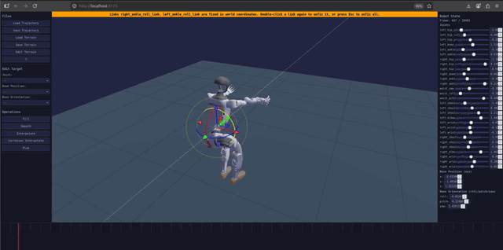

# Robot Trajectory Editor

Web-based editor for inspecting, repairing, and authoring robot joint and floating-base trajectories directly against a URDF model in 3D.

Teaser: 

## Key Features

- **Trajectory I/O and playback**: load and save `.npz` motions, scrub or play them on a URDF robot, and inspect or numerically edit every joint and base channel.
- **Visual timeline editing**: draw channel values by dragging keyframes, select time segments, and apply fill, smoothing, joint-space interpolation, nudging, and multi-level undo.
- **Trajectory base transform**: shift and rotate the entire base position/orientation sequence with live sliders (`x`/`y`/`z`/`roll`/`pitch`/`yaw`) — updates the 3D view and timeline in real time, confirmed with Apply and revertable with a single `Ctrl+Z`.
- **Direct 3D manipulation**: drag robot links with IK, translate or rotate the base, and pin multiple links to world-space poses while editing the motion.
- **Cartesian trajectory interpolation**: interpolate selected link targets linearly or cubically with per-link position-only or full-pose constraints; floating-base IK solves each frame transactionally.
- **Terrain workflow**: load `.obj` or `.stl` terrain, crop, down-sample, move, rotate, and export the edited mesh as `.obj`.
- **Keyboard-first navigation**: step frames, mark timeline segments, cycle Edit Targets within their channel groups, nudge values, play, save, and undo without leaving the viewport.

## Quick Start

```bash
# Launch both backend + frontend (prompts to install missing Python/npm dependencies)
./launch.sh [--robot-urdf /path/to/robot.urdf] [--port 5000] [--nudge-step 0.01] [--frame-step 1]
```

Then open http://localhost:5173.

### Manual launch

#### 1. Start Backend

```bash
cd robot_trajectory_editor/backend
pip install -r requirements.txt
python app.py --robot-urdf /path/to/robot.urdf --port 5000
```

#### 2. Start Frontend

```bash
cd robot_trajectory_editor/frontend
npm install
npm run dev
```

Open http://localhost:5173 in a browser.

## Testing

```bash
# Backend tests
cd robot_trajectory_editor/backend && pytest tests/ -v

# Frontend tests
cd robot_trajectory_editor/frontend && npm test
```

## Architecture

- **Backend**: Flask + numpy for `.npz` trajectory I/O and URDF asset serving
- **Frontend**: React + TypeScript + Vite, Three.js for 3D visualization, zustand for state
- **IK**: `closed-chain-ik`, wrapped by `frontend/src/three/IkSolver.ts`; direct manipulation keeps the trajectory-driven base locked, while Cartesian interpolation solves the floating base and joints together
- **Terrain**: `.obj` and `.stl` load client-side; Save Terrain exports `.obj`

## Viewport Interaction

- Left-drag a body link: IK-drag that link (joints solve, base stays)
- Left-drag the base (root) link: translate the base (grab offset preserved)
- Shift+drag the base: yaw the base around world Z through its origin
- Double-click a link: pin it at its current world pose (highlighted); dragging then moves the base while IK keeps the link fixed. Double-click again or Esc to unpin

## Timeline Interaction

- Click / drag: scrub playhead; mouse wheel: step frames
- Alt + mouse wheel: zoom the timeline around the pointer; two-finger pinch: zoom and pan the visible frame range
- The visible frame/value ranges are labeled; drag the global navigator's left/right or top/bottom edges to adjust them
- Shift+drag: select segment (Fill/Smooth apply to it; Esc clears)
- `I` / `O`: set the segment start/end to the current playhead frame; when used alone, the other endpoint defaults to the timeline end/start; `U`: clear it
- Double-click: add keyframe anchor at that frame
- Drag a keyframe with a mouse or pen like a drawing pen: horizontal = time, vertical = selected channel value; the playhead and 3D scene follow
- Right-click keyframe: remove it

## Cartesian Interpolation

Select a timeline segment, click **Cartesian Interpolate**, choose one or more links, select a position-only or position-and-orientation constraint for each, and choose a linear or cubic method. Link targets are interpolated in world space and solved back to the floating-base pose and joint positions with IK. For jumps, full torso pose plus position-only ankle targets avoids overconstraining straight legs. The edit is transactional: if IK fails on any frame, the trajectory remains unchanged.

## Keyboard Shortcuts

- `Up` / `Down`: nudge the selected Edit Target's value at the current frame by `--nudge-step`
- `Left` / `Right`: step the current frame backward/forward by `--frame-step` (works with or without an Edit Target selected)
- `,` / `.`: select the previous/next Edit Target, wrapping within the current Joint, Base Position, or Base Orientation block
- `Space`: toggle trajectory playback (play/pause)
- `I` / `O`: set the selected segment's start/end to the current playhead frame (a lone `I` selects to the timeline end; a lone `O` selects from the timeline start; selecting a start after the existing end resets the end to the timeline end)
- `U`: clear the selected timeline segment
- `Esc`: unpin the pinned link, or clear the segment selection

## CLI Options

```
python backend/app.py --robot-urdf <path> [--port 5000] [--host 127.0.0.1] [--nudge-step 0.01] [--frame-step 1]
```

- `--robot-urdf`: Local path to a URDF file
- `--port`: Flask server port (default 5000)
- `--host`: Flask server host (default 127.0.0.1)
- `--nudge-step`: Value step applied by the Up/Down arrow keys on the selected edit target (default 0.01)
- `--frame-step`: Frame step applied by the Left/Right arrow keys (default 1)

## `.npz` Format

| Key | Shape | dtype | Meaning |
|---|---|---|---|
| `framerate` | `[]` (0-d) | float32 | trajectory framerate |
| `joint_names` | `(N,)` | str | ordered joint names |
| `joint_pos` | `(F, N)` | float32 | joint position sequence |
| `base_pos_w` | `(F, 3)` | float32 | base position, world xyz |
| `base_quat_w` | `(F, 4)` | float32 | base orientation, world wxyz |

## Trajectory Optimize

**Trajectory Optimize** optimizes the entire edited motion, regardless of the timeline
selection. Every keyframe anchor fixes all joints and the full base pose exactly.
Without anchors, every frame is eligible. Successful results update the editor as
one undo step. Solver/model/validation failures preserve the original data;
results are also discarded if the trajectory or scene changes during the request.

Install the optional dynamics dependencies in the backend environment:

```bash
pip install -r robot_trajectory_editor/backend/requirements-trajectory-optimize.txt
```

Trajectory Optimize uses Pinocchio inverse dynamics, a cubic Hermite configuration curve,
and the original fixed `dt = 1 / framerate`. Every free frame configuration and
all internal node velocities participate in the optimization; fixed keyframe
configurations are omitted from the decision vector. The objective stays close
to the edited configuration sequence.

Support/contact forces are enabled. **Terrain friction μ** in the Operations
panel defaults to **0.7** and accepts any finite nonnegative value. The API field
is `friction`, also defaulting to `0.7`. No contact labels are required: collision
geometry within `1e-3` m of the terrain supplies candidate point contacts. Each
uses a unilateral force and a four-ray pyramid inside the Coulomb friction cone.
The 1 mm contact-inference margin is separate from the `1e-5` m non-penetration
acceptance tolerance.
OSQP distributes these forces together with bounded joint torques to explain
inverse dynamics. The remaining floating-base force must vanish, and joint
torques must satisfy the available URDF effort limits. Geometry penetration is
allowed only during the search; output must pass non-penetration validation.
This is a point-support model: it does not impose a sticking/sliding schedule,
no-slip constraints, or a frictional dissipation law.

The default contact solver uses L-BFGS-B penalty stages over the whole
trajectory. An experimental augmented-Lagrangian path with per-sample multipliers
for the base forces and actuator bounds is available with
`TRAJECTORY_OPTIMIZE_SOLVER=augmented`; it improves some mean residuals but is not
yet robust on every motion. Constraint samples are at both interval endpoints and
two interior Gauss points. Free nodal velocities start from the reference finite
differences clipped to the URDF velocity limits. Free positions are smoothed
(Savitzky-Golay) before the solve. Ground alignment uses exact shape distances:
a 21-frame median window identifies nearby upward-facing support geometry,
including seated/body support. A cubic spline with knots about 0.3 seconds apart
fits the vertical base offset, with zero offset at fixed keyframes. Knots lie on
trajectory nodes and the spline's analytic velocities are added with its positions,
so Hermite reconstruction preserves the smooth correction. This only initializes
the search; candidate contacts still require the 1 mm gap at each sample.
`TRAJECTORY_OPTIMIZE_SMOOTH`, `TRAJECTORY_OPTIMIZE_OUTERS` and
`TRAJECTORY_OPTIMIZE_MAXITER` tune the warm start and inner iterations. Sample evaluation is distributed over forked
worker processes (`TRAJECTORY_OPTIMIZE_WORKERS`, default 6 with a loaded terrain and up to
16 on flat ground) because independent interval blocks dominate the runtime.
The solver and penalties guide the search; they do not relax the acceptance
tolerances.
The pool uses `fork` so workers inherit the loaded model and terrain; set
`TRAJECTORY_OPTIMIZE_WORKERS=1` to force serial evaluation. Trajectory Optimize has a 45-second
computation budget, checked between samples. A check
or model setup already in progress can slightly overrun that budget. A timeout
is a failure and never applies a partial result. This budget is **not a claim of
successful trajectory optimization within 45 seconds**; see the measured limitations below.

The model must provide inertial data for physical bodies and collision geometry,
with a complete one-to-one mapping between trajectory joints and movable URDF joints. Revolute,
continuous and prismatic joints are supported; mimic and other joint types report
an unsupported-model diagnostic. Empty fixed sensor/coordinate frames may omit
inertial data. Non-penetration uses the supplied URDF collision shapes; visual
meshes are not substituted for collision geometry. Available URDF position,
velocity and effort limits are enforced. Missing meshes or inertial data produce an error.
The currently edited terrain is sent in world coordinates. Without terrain,
collision geometry must stay above the `z=0` ground halfspace. Loaded OBJ geometry
is treated as triangle surfaces. A watertight mesh with positive winding volume
also excludes its interior; a negative-volume mesh encloses free space (for
example a scanned room), so its interior is not treated as solid. Open meshes do
not define an underground solid volume. Loaded-terrain surface
intersections are also checked independently; coincident touching mesh surfaces
can be rejected conservatively when a penetration depth is unavailable.

Validation evaluates the reconstructed curve at **17 samples per frame interval**,
including both one-sided endpoint accelerations, after converting the result to
the float32 representation retained by the editor. Tolerances are: base dynamics
0.1% of robot weight in N (and weight times a 1 m reference length in Nm), with
a `1e-3` N/Nm floor to account for float32 differentiation; position `1e-6` m/rad;
joint velocity `1e-6` m/s or rad/s;
effort `1e-4` N/Nm; penetration `1e-5` m; quaternion norm error `1e-6`.
The response reports measured residuals and tolerances. These are numerical
sample checks, not a mathematical certificate for every instant. Velocities and
torques are internal to Trajectory Optimize; the saved NPZ schema is unchanged.

Pinocchio supplies articulated dynamics derivatives. The support penalty uses
an envelope gradient of the force-allocation problem: external-force dynamics
derivatives are combined with an analytic six-dimensional contact-pose wrench
derivative, avoiding repeated QP solves or per-coordinate distance queries.
Collision derivatives use contact point Jacobians. A conservative coarse AABB
grid skips exact terrain queries for shapes provably more than 1 mm away. Terrain containment queries are batched, and collision
values/derivatives are reused for the same candidate; final validation performs
fresh collision queries. Rotation-vector coordinates must remain below
`2*pi - 0.01` in norm to avoid a singular chart.

Remote regression tests cover fixed standing support, repair of simple ground
penetration, friction and actuator limits, floating-base dynamics derivatives,
contact penalty derivatives, terrain containment, exact keyframes, failure
preservation, and single-step undo. Successful real-model free-flight checks
from the earlier contact-free implementation do **not** establish supported
whole-motion performance. The Python-only `friction=None` path retains that
contact-free formulation for regression/benchmark comparisons; the editor uses
support forces.

For the project-local test installation on that host, activate `omniretargeting`
and run `.venv-processing/bin/python` from `/data/Projects/robot_trajectory_editor`.
The shared conda environment has not been modified. To launch with those
dependencies, run `source .venv-processing/bin/activate` before `./launch.sh`.

### Trajectory Optimize performance benchmark

`scripts/benchmark_trajectory_optimize.py` measures the first 750 frames of a real NPZ
without keyframes, preserving its original frame rate. Run it on the configured
compute host with the optimizer Python environment:

```bash
# Evaluate contact constraints and their gradient:
timeout 120s .venv-processing/bin/python scripts/benchmark_trajectory_optimize.py \
  /path/to/motion.npz /path/to/robot.urdf --terrain /path/to/terrain.obj
# Run the actual solver with configurable friction:
timeout 120s .venv-processing/bin/python scripts/benchmark_trajectory_optimize.py \
  /path/to/motion.npz /path/to/robot.urdf --terrain /path/to/terrain.obj \
  --mode solve --iterations 40 --friction 0.7
```

Omit `--terrain` for the default ground. `--frames` selects a prefix without
changing the source frame rate. `--contact-free` is available for historical
solver comparisons. The script reports setup, completed objective evaluations,
validation success or the failure diagnostic. Original files are never modified.

Test data on `ziwen-galaxea-desktop-rustdesk`:

- Nokov G1: `~/Datasets/NoKov-Marslab-Motions-instinctnpz/20251114_50cm_diveRoll4_highClimb_jumpSit_rollVault/`
  (`50cmBoxes_noWall/*.npz` with `50cmboxes_noWall.stl`, 90 fps, 29 joints). The STL
  is converted to OBJ for the app/benchmark.
- Kengo: `~/Datasets/HiPhi_selected/kengo_retargeted_20260910/motions/` with
  `kengo_with_fist.urdf` and default flat ground, 90 fps, 23 joints.
- Robot URDF for G1: `~/Projects/project-instinct/instinctlab3/source/instinctlab/instinctlab/assets/resources/unitree_g1/urdf/g1_29dof_torsobase_popsicle.urdf`
- μ = 0.7, no fixed keyframes for these benchmarks.

Solver runs with the 45-second budget, μ = 0.7:

| Motion prefix | Frame rate | Result |
|---|---:|---|
| Nokov `jumpsit2`, 750 of 967 frames, 50 cm boxes | 90 fps | 45.03 s timeout. Initial dynamics 787 N, effort 403 Nm. Near the budget: dynamics 406 N, effort 264 Nm, clearance 8 mm, velocity 0. No result applied |
| Nokov `rollVault11`, 750 of 942 frames, 50 cm boxes | 90 fps | 45.03 s timeout. Initial dynamics 404 N, effort 87 Nm. Near the budget: dynamics 434 N, effort 238 Nm, clearance 2 mm. No result applied |
| Kengo `vault_0068`, 750 of 1310 frames, flat ground | 90 fps | Optimizer terminated on stage iteration limits after 27.5 s; best base-dynamics residual 295 N (tolerance 0.41 N). No result applied |

Acceptance tolerances are 0.1% of body weight for dynamics (0.33–0.41 N here),
`1e-4` Nm for effort, `1e-5` m for penetration, and `1e-6` for velocity. The
best observed mid-search iterates are still orders of magnitude above these.

### Feasibility audit

`scripts/audit_feasibility.py` runs the same collocation samples and support-force
allocation as Trajectory Optimize, but skips the optimizer. It reports reference residuals
and how many samples have inferred contacts. Use `--smooth 21 --align` to apply a
0.23 s Savitzky-Golay smoothing and a smoothed ground-alignment offset, matching
what a retargeting repair would need to do before the dynamics are plausible.

Reference audits (smoothed + aligned), μ = 0.7:

| Motion | Frames | Contact-free samples (raw) | Max dynamics | Max effort | Max penetration |
|---|---:|---:|---:|---:|---:|
| Nokov `jumpsit2` | 967 | 23% | 1,391 N | 199 Nm | 14 mm |
| Nokov `rollVault11` | 942 | 90% | 2,653 N | 427 Nm | 20 mm |
| Nokov `highClimbRight1` | 1,199 | 72% | 2,174 N | 986 Nm | 30 mm |
| Nokov `diveroll4` | 751 | 92% | 2,463 N | 532 Nm | 15 mm |
| Kengo `walk_0052` | 5,549 | ~100% | 4,586 N | 213 Nm | 8 mm |
| Kengo `run_0148` | 5,438 | ~100% | 3,705 N | 392 Nm | 9 mm |
| Kengo `vault_0068` | 1,310 | ~100% | 4,396 N | 150 Nm | 4 mm |

Without smoothing/alignment the raw references are much worse (for example,
Nokov `rollVault11` reaches 33 kN base residual and 3.9 kNm effort violation).
The Kengo references float 1–55 mm above `z=0`; at the Trajectory Optimize contact
threshold of `1e-4` m almost no contacts are inferred until the ground is
aligned. Even after smoothing and alignment, every reference is far outside the
actuator and base-dynamics tolerances. These motions are kinematically retargeted,
not physically feasible references, so Trajectory Optimize has to change them
substantially rather than make a small correction. Whether a feasible nearby
trajectory exists is still an open solver question.
